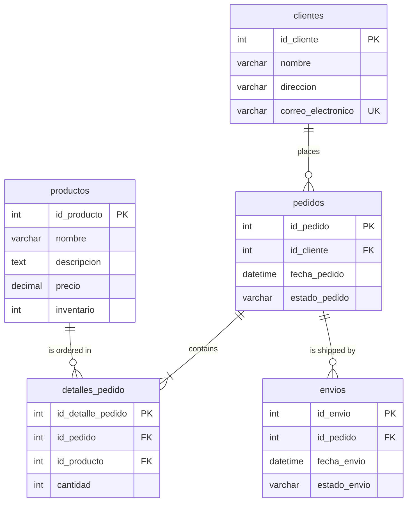

# Online Store Database (MySQL)

[](https://github.com/anCar16/sql-ecommerce-database/actions/workflows/tests.yml)

A relational database for an online store, with a stored procedure that places orders **atomically**: it validates stock, creates the order, its line and a pending shipment, and decrements inventory in a single transaction, or writes nothing at all. Every behaviour is covered by automated tests that run on MySQL 8 in CI.

## Data model



Identifiers are in Spanish (the original business context). Constraints enforce integrity at the database level: foreign keys, unique e-mails, non-negative prices and stock, and positive quantities.

## The `realizar_pedido` procedure

```sql
CALL realizar_pedido(p_id_cliente, p_id_producto, p_cantidad, @resultado);
```

| Situation | Result |
|---|---|
| Enough stock | Order, order line and shipment created, stock decremented, `@resultado = 1` |
| Ordering exactly the remaining stock | Allowed |
| Not enough stock / unknown product / quantity ≤ 0 | Error `45000` with a readable message, nothing written |
| Unknown customer | Foreign-key error, transaction rolled back |

Design choices:

- **`SELECT ... FOR UPDATE`** locks the product row, so two concurrent orders cannot sell the same units twice.
- **An exit handler** rolls back and re-raises any error, so a failure halfway through never leaves a partial order.
- **Prefixed names** (`p_` for parameters, `v_` for variables). See the bug below.

### A bug worth knowing about

The first version of this procedure named its parameter `id_producto`, exactly like the column. In MySQL, `WHERE id_producto = id_producto` then compares the parameter with itself, which is always true. Ordering 2 T-shirts decremented the stock of **every** product by 2, and the stock check read whichever product came first. The tests `only the ordered product loses stock` and `failed order writes nothing` now guard against it.

## Example queries

[`sql/04_example_queries.sql`](sql/04_example_queries.sql) shows revenue by product, customers with their total spend (including customers without orders), undelivered orders with their shipment status, and products below a reorder point.

## Run it

With Docker:

```bash
docker run -d --name store-db -e MYSQL_ROOT_PASSWORD=root -p 3306:3306 mysql:8.4
# wait a few seconds for MySQL to start, then:
MYSQL="mysql -h127.0.0.1 -uroot -proot" ./tests/run_tests.sh
```

Or run the scripts in order in MySQL Workbench if installed: `01_schema.sql`, `02_seed_data.sql`, `03_place_order_procedure.sql`, `04_example_queries.sql`.

## Project structure

```
sql/
  01_schema.sql                 tables and constraints
  02_seed_data.sql              sample data
  03_place_order_procedure.sql  transactional order procedure
  04_example_queries.sql        analytical queries
tests/run_tests.sh              builds the database and checks 13 behaviours
.github/workflows/tests.yml     runs the tests on MySQL 8 for every push
```
